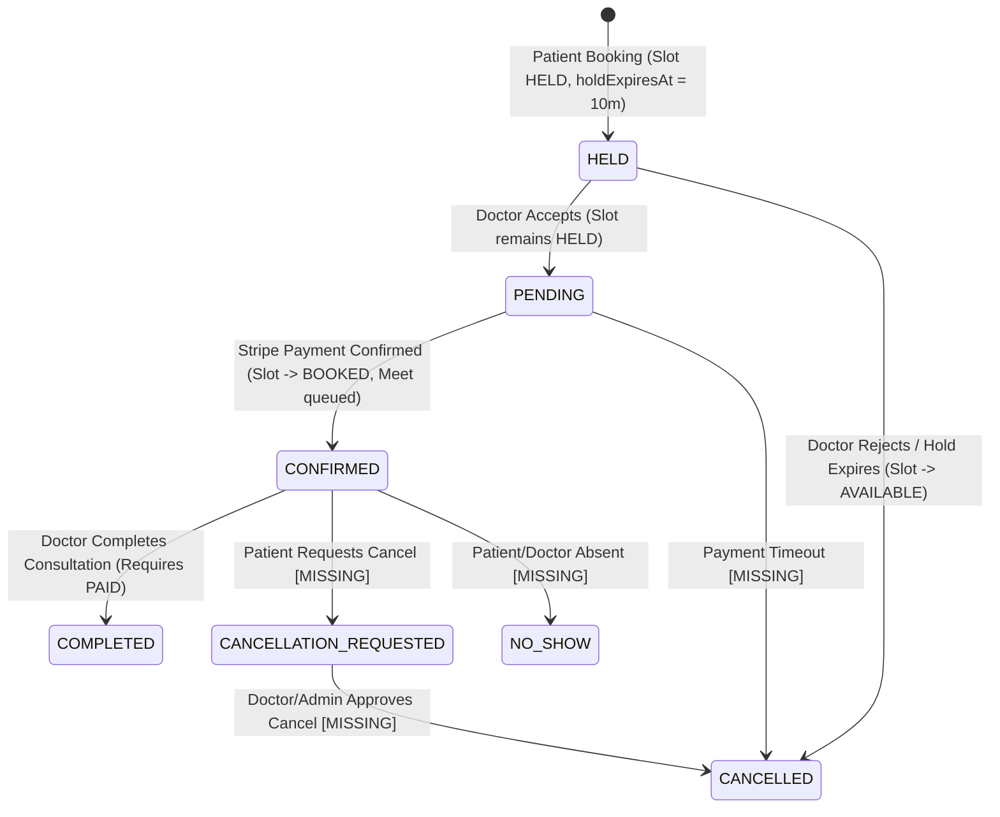
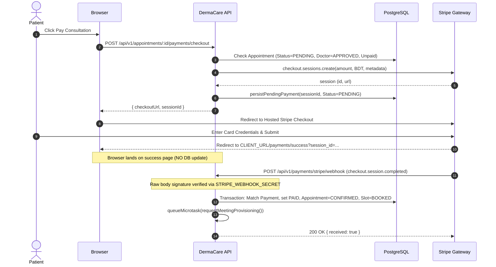

# DermaCare AI — Comprehensive Backend Architecture, Security & Production Readiness Audit

**Audit Date:** October 21, 2026  
**Auditor:** Senior Backend Architect, Security Engineer & QA Lead  
**Scope:** Entire DermaCare AI Backend Repository (`TypeScript`, `Express.js`, `Prisma 7`, `PostgreSQL/Neon`, `Stripe`, `Google Calendar/Meet`, `Cloudinary`, `ONNX AI`, `JWT`)  
**Repository State:** Branch `yeasin`, Commit `2b24d93`  
**Execution Mode:** Read-Only Audit & Static/Dynamic Code Verification  

---

## Table of Contents
1. [A. Executive Summary & Production Readiness Verdict](#a-executive-summary--production-readiness-verdict)
2. [B. Module-by-Module Status Matrix](#b-module-by-module-status-matrix)
3. [C. Comprehensive Audit Findings Ranked by Severity](#c-comprehensive-audit-findings-ranked-by-severity)
   - [Critical Severity Findings](#critical-severity-findings)
   - [High Severity Findings](#high-severity-findings)
   - [Medium Severity Findings](#medium-severity-findings)
   - [Low Severity Findings](#low-severity-findings)
4. [D. Appointment State Transition Matrix](#d-appointment-state-transition-matrix)
5. [E. Stripe Payment & Webhook Flow Analysis](#e-stripe-payment--webhook-flow-analysis)
6. [F. Notification Event & Recipient Matrix](#f-notification-event--recipient-matrix)
7. [G. API Inventory & Missing Endpoint Analysis](#g-api-inventory--missing-endpoint-analysis)
8. [H. Database Integrity & Migration Assessment](#h-database-integrity--migration-assessment)
9. [I. Security & Privacy Assessment](#i-security--privacy-assessment)
10. [J. Test Results & Coverage Gaps](#j-test-results--coverage-gaps)
11. [K. Production Environment & External Integration Checklist](#k-production-environment--external-integration-checklist)
12. [L. Prioritized Remediation Roadmap](#l-prioritized-remediation-roadmap)
13. [M. Final Go/No-Go Recommendation](#m-final-gono-go-recommendation)

---

## A. Executive Summary & Production Readiness Verdict

### Production Readiness Verdict: **NO-GO (CRITICAL BLOCKERS)**

DermaCare AI demonstrates thoughtful architectural foundations in domain modeling, atomic database operations, role-based JWT authentication, timing-safe cryptographic comparisons, and state machine isolation. However, **the application cannot be released to production in its current state**.

The audit identified **4 CRITICAL vulnerabilities/blockers**, **9 HIGH severity defects**, **19 MEDIUM reliability/contract defects**, and **4 LOW issues** (total: 36 findings).

### Critical Blockers Summary:
1. **Unprotected Sandbox Payment Bypass (`PAY-01` — CRITICAL):** The demo payment endpoints (`POST /appointments/:id/payments` and `POST /orders/:id/payments`) are mounted in production routes alongside Stripe. Any authenticated patient can call them with an empty body to confirm appointments and orders for free without paying via Stripe.
2. **User Profile Lockdown (`ARCH-01` — CRITICAL):** Base user profile routes (`/users/me`) are guarded by `authorize(Role.ADMIN)` and service-level `requireActiveAdmin`. Regular Patients and Doctors receive `403 Forbidden` when attempting to fetch or update their basic profile information.
3. **Permanent Doctor Slot Lockout on Unpaid Appointments (`APPT-01` — CRITICAL):** When a doctor accepts an appointment (`HELD` → `PENDING`), `holdExpiresAt` is wiped to `null`. If the patient abandons payment, the appointment stays `PENDING` and the doctor's slot remains locked in `SlotStatus.HELD` indefinitely. There is no expiration deadline, payment timeout, or background cleaner for unpaid appointments.
4. **Missing Clinical Red-Flag Questionnaire Data (`AI-01` — CRITICAL):** The preliminary AI screening endpoint only accepts a free-text `symptoms` string. The structured red-flag safety questionnaire (bleeding, rapid lesion expansion, systemic fever, ulceration) does not exist in schema or validation. As a result, `redFlagDetected` is always `false`, completely neutralizing the core medical safety override mechanism that escalates acute emergencies.

---

## B. Module-by-Module Status Matrix

| Module # | Module Name | Proposed Endpoints | Implemented & Mounted | Status | Primary Audit Concerns |
|:---:|:---|:---:|:---:|:---:|:---|
| **01** | Authentication | 9 | 10 | **PARTIAL** | Path mismatch vs 84-API spec; hard 500 error on registration if SMTP unconfigured; no access token revocation on password change. |
| **02** | Unified Profiles | 3 | 2 | **BROKEN** | `/users/me` is hardcoded to Admin only; patients and doctors cannot access their own base profile. |
| **03** | Patient Medical Records | 4 | 5 | **COMPLETE** | Patient dashboard and medication tracker implemented; verified ownership checks. |
| **04** | Doctor Discovery & Profiles | 6 | 3 | **PARTIAL** | Raw Prisma join tables exposed instead of formatted specialization presenter; missing doctor license endpoint. |
| **05** | Doctor Availability & Booking | 11 | 6 | **BROKEN** | No appointment cancellation endpoints; `PENDING` hold expiry absent (permanent slot lockout); missing `DELETE` slot endpoint. |
| **06** | Telemedicine & Consultations | 6 | 2 | **PARTIAL** | Doctor completion implemented; Google Meet URLs lack attendees; no SOAP note authoring endpoint. |
| **07** | Prescriptions & Medication | 7 | 6 | **PARTIAL** | Strictly requires pre-existing store catalog medicine UUIDs (doctors cannot prescribe uncataloged drugs); missing `GET /prescriptions`. |
| **08** | Post-Consultation Chat | 4 | 3 | **COMPLETE** | 7-day post-consultation window enforced; chronological cursor polling implemented; missing rate limiting. |
| **09** | Digital Pharmacy & Store | 6 | 6 | **COMPLETE** | Inventory deduction and restoration concurrency-safe; price recalculation verified. |
| **10** | Sandbox & Live Payments | 6 | 6 | **BROKEN** | Unprotected demo payment bypass active in production; no automated Stripe refund on order cancellation. |
| **11** | Invoices & Refunds | 4 | 0 | **UNVERIFIED / MISSING** | No models, routes, or Stripe refund logic implemented. |
| **12** | AI Skin Screening | 7 | 6 | **BROKEN** | 343MB unquantized model risks OOM crashes; red-flag questionnaire missing; consecutive image uploads overwrite predictions. |
| **13** | Admin Operations | 9 | 14 | **COMPLETE** | Dashboard, payouts, user management, doctor approvals, and audit logs operational. |
| **14** | Subscriptions | 5 | 0 | **UNVERIFIED / MISSING** | No models, routes, or Stripe billing logic implemented. |
| **15** | Advertisements & Sponsored | 3 | 0 | **UNVERIFIED / MISSING** | No models or routes implemented. |
| **16** | System & Compliance | 4 | 2 | **PARTIAL** | Health check and audit logs operational; no maintenance mode or central config. |

---

## C. Comprehensive Audit Findings Ranked by Severity

### Critical Severity Findings

#### `PAY-01` — Unprotected Sandbox "Demo" Payment Endpoints Callable in Production
- **Severity:** CRITICAL
- **Type:** CONFIRMED BUG / FINANCIAL VULNERABILITY
- **Module:** Module 10 (Payments)
- **Evidence:** `src/modules/payments/payments.routes.ts` lines 16–20 & 32–35; `src/modules/payments/services/payment.service.ts` lines 54–195 & 238–352.
- **Impact & Scenario:**
  ```http
  POST /api/v1/appointments/550e8400-e29b-41d4-a716-446655440000/payments HTTP/1.1
  Authorization: Bearer <patient_token>
  Content-Type: application/json
  
  {}
  ```
  The server creates a `provider: "DEMO"` payment record, confirms the appointment, transitions the doctor's slot to `BOOKED`, and triggers Google Meet provisioning without charging the patient. The same vulnerability exists on `POST /api/v1/orders/:id/payments`.
- **Recommended Fix:** Guard demo payment routes behind `if (env.NODE_ENV === "production") throw new AppError("Demo payment disabled in production", 403);` or deprecate them entirely in favor of hosted Stripe Checkout.
- **Dependencies:** None. Priority 1.

#### `ARCH-01` — `/users/me` Profile Locked to Admin Only
- **Severity:** CRITICAL
- **Type:** CONFIRMED BUG / BROKEN ACCESS CONTROL
- **Module:** Module 02 (Unified Profiles)
- **Evidence:** `src/routes/index.ts` lines 36–40; `src/modules/user/services/user-profile.service.ts` lines 22–40.
  ```typescript
  // src/routes/index.ts line 36
  apiRouter.use("/users", authenticate, authorize(Role.ADMIN), userRoutes);

  // src/modules/user/services/user-profile.service.ts line 33
  if (!user) throw new AppError("Active administrator profile not found", 403);
  ```
- **Impact & Scenario:** Any non-admin calling `GET /api/v1/users/me` or `PATCH /api/v1/users/me` receives a `403 Forbidden` error. Regular patients and doctors cannot view or edit their core user fields (`name`, `phone`).
- **Recommended Fix:** Mount `userRoutes` with `authorize(Role.PATIENT, Role.DOCTOR, Role.ADMIN)` and replace `requireActiveAdmin` in `userProfileService` with `requireActiveUser`.
- **Dependencies:** None. Priority 1.

#### `APPT-01` — Unpaid `PENDING` Appointments Have No Expiration / Permanent Slot Lockout
- **Severity:** CRITICAL
- **Type:** CONFIRMED BUG / BUSINESS LOGIC DEFECT
- **Module:** Module 05 (Appointments)
- **Evidence:** `src/modules/doctors/services/doctor-appointment.service.ts` line 150.
  ```typescript
  data: {
    status: AppointmentStatus.PENDING,
    holdExpiresAt: null, // Cleared upon doctor acceptance
  }
  ```
- **Impact & Scenario:** When a doctor accepts an appointment, `holdExpiresAt` is set to `null`. The appointment status becomes `PENDING` and the slot status remains `SlotStatus.HELD`. If the patient never pays, the slot stays reserved indefinitely. No other patient can book that slot, and the doctor cannot remove it, causing permanent calendar lockout.
- **Recommended Fix:**
  1. Set a payment deadline when accepting: `holdExpiresAt: new Date(Date.now() + 15 * 60 * 1000)` (or slot start time, whichever is earlier).
  2. Implement an appointment expiration cleaner in `src/server.ts` similar to `cleanupExpiredUnpaidOrders`.
- **Dependencies:** `PAY-01`. Priority 1.

#### `AI-01` — Absence of Structured Red-Flag Questionnaire Data
- **Severity:** CRITICAL
- **Type:** CONFIRMED CLINICAL SAFETY DEFECT
- **Module:** Module 12 (AI Skin Screening)
- **Evidence:** `src/modules/screenings/screenings.validation.ts` line 5; `src/modules/screenings/services/screening-questionnaire.service.ts` lines 18–32.
  ```typescript
  export const createScreeningSchema = z.object({
    symptoms: z.string().trim().min(1).max(5000),
  }).strict();
  ```
- **Impact & Scenario:** `redFlagDetected` defaults to `false` in Prisma. Because `createScreening` only accepts a free-text `symptoms` string, clinical red flags (spontaneous bleeding, rapid growth, systemic infection) are never captured as structured booleans. In `deriveScreeningSafety(predictions, screening.redFlagDetected)`, `redFlagDetected` is always `false`, disabling the critical safety override that forces immediate clinical review for acute emergencies.
- **Recommended Fix:** Extend `createScreeningSchema` to accept structured clinical red-flag questions (e.g. `hasBleeding: boolean`, `rapidGrowth: boolean`, `hasFever: boolean`) and set `redFlagDetected = true` if any are answered affirmatively.
- **Dependencies:** None. Priority 1.

---

### High Severity Findings

#### `AUTH-01` — API Contract Mismatch for All Authentication Routes
- **Severity:** HIGH
- **Type:** CONFIRMED BUG / CONTRACT BREACH
- **Module:** Module 01 (Authentication)
- **Evidence:** `src/modules/auth/auth.routes.ts` lines 18–34 vs `src/docs/endpoints/m01_auth.ts`.
  | Documented MVP Spec | Actual Mounted Route |
  |:---|:---|
  | `POST /auth/register` | `POST /auth/register/request-otp` |
  | `POST /auth/verify-otp` | `POST /auth/register/verify-otp` |
  | `POST /auth/resend-otp` | `POST /auth/register/resend-otp` |
  | `POST /auth/refresh-token` | `POST /auth/refresh` |
  | `POST /auth/forgot-password` | `POST /auth/forgot-password/request-otp` |
  | `POST /auth/reset-password` | `POST /auth/forgot-password/reset` |
- **Impact:** Frontend applications built against the documented 84-endpoint contract fail with `404 Not Found`.
- **Recommended Fix:** Add route aliases in `src/modules/auth/auth.routes.ts` so both canonical MVP paths and sub-action paths are handled.

#### `AUTH-02` — Hard 500 Failure of Registration & Password Reset When SMTP Is Unconfigured
- **Severity:** HIGH
- **Type:** CONFIRMED BUG / RELIABILITY
- **Module:** Module 01 (Authentication)
- **Evidence:** `src/shared/services/email.service.ts` lines 57–64.
  ```typescript
  if (!transporter) {
    if (env.NODE_ENV === "production") {
      throw new AppError("Email service is not configured", 500);
    }
    throw new AppError("Email service is not configured", 500);
  }
  ```
- **Impact:** Local testing, staging environments, and deployments without SMTP credentials crash on registration with HTTP 500.
- **Recommended Fix:** In development/staging (`env.NODE_ENV !== "production"`), log the OTP to a secure debug stream or return a mock transport if `SMTP_HOST` is omitted.

#### `ARCH-02` — Missing Environment Validation for `DATABASE_URL` and `CLOUDINARY_*`
- **Severity:** HIGH
- **Type:** POTENTIAL RISK / CONFIGURATION DEFECT
- **Module:** Core Architecture
- **Evidence:** `src/config/env.ts` lines 9–61; `src/lib/prisma.ts` line 5; `src/shared/services/cloudinary/cloudinary.service.ts` lines 12–18.
- **Impact:** `DATABASE_URL`, `CLOUDINARY_CLOUD_NAME`, `CLOUDINARY_API_KEY`, and `CLOUDINARY_API_SECRET` bypass Zod validation at startup. If Cloudinary keys are omitted or malformed, the server boots without warning and crashes on the first patient image upload with a 503 error.
- **Recommended Fix:** Add all mandatory external service credentials to `envSchema` in `src/config/env.ts`.

#### `DOC-01` — Missing Specialization Presenter in Public Doctor Listing & Detail
- **Severity:** HIGH
- **Type:** CONFIRMED BUG / API CONTRACT
- **Module:** Module 04 (Doctor Discovery)
- **Evidence:** `src/modules/doctors/services/doctor-list.service.ts` lines 53–57 & 99–101.
- **Impact:** `getApprovedDoctors` queries raw Prisma join table relations `specializations: { include: { specialization: true } }`. The output exposes `[{ doctorId, specializationId, specialization: { id, name } }]` instead of using `presentDoctorSpecializations(...)` to produce `{ specialization: { id, name }, specializations: [...] }`. Frontend cards expecting top-level `specialization` render blank.
- **Recommended Fix:** Map results through `presentDoctorSpecializations(doctor.specializations)`.

#### `APPT-02` — Complete Absence of Patient and Doctor Cancellation Endpoints
- **Severity:** HIGH
- **Type:** MISSING FEATURE / WORKFLOW DEFECT
- **Module:** Module 05 (Appointments)
- **Evidence:** `src/modules/appointments/appointments.routes.ts`; `src/modules/doctors/doctors.routes.ts`.
- **Impact:** Endpoints `POST /appointments/:id/cancellation-request`, `PATCH /appointments/:id/cancellation`, and `POST /appointments/:id/cancel` are not implemented. Patients cannot cancel upcoming visits, and doctors cannot directly cancel appointments for clinical emergencies.
- **Recommended Fix:** Implement cancellation request and approval services with atomic slot release back to `AVAILABLE`.

#### `PAY-02` — Race Condition Between Stripe Session Creation and Local Database Record
- **Severity:** HIGH
- **Type:** CONCURRENCY & INTEGRATION RISK
- **Module:** Module 10 (Payments)
- **Evidence:** `src/modules/payments/services/payment-verification.service.ts` lines 122–144.
  ```typescript
  const session = await stripe().checkout.sessions.create(...);
  await persistPendingPayment({ sessionId: session.id, ... });
  ```
- **Impact:** The Stripe session is created on Stripe's servers before being persisted locally. If the local database write fails or network blips, the user pays on Stripe, but DermaCare AI's database has no record of the session. The webhook then throws `400 Bad Request` (`Stripe checkout session is not registered`).
- **Recommended Fix:** Persist the `PaymentTransaction` record with a client-generated reference ID prior to calling Stripe, or handle unindexed session creation gracefully in the webhook.

#### `MEET-01` — All Consultations Booked into Single Primary Google Calendar Without Attendees
- **Severity:** HIGH
- **Type:** ARCHITECTURAL LIMITATION / PRIVACY
- **Module:** Module 06 (Consultations)
- **Evidence:** `src/integrations/google-calendar/google-meet.service.ts` lines 25–41.
- **Impact:** Every appointment across all doctors is inserted into `env.GOOGLE_CALENDAR_ID` (default "primary").
  1. Neither the doctor's nor patient's email is included in `requestBody.attendees`. The event never appears on either party's calendar.
  2. High platform volume will hit Google Calendar's per-user rate limit (10 writes/sec), causing provisioning failures.
- **Recommended Fix:** Populate `attendees: [{ email: patient.email }, { email: doctor.email }]` and explore doctor-specific Google Calendar integration or service accounts.

#### `RX-01` — Doctors Can Only Prescribe Pre-Existing Catalog Medicines
- **Severity:** HIGH
- **Type:** SCHEMA / CLINICAL LIMITATION
- **Module:** Module 07 (Prescriptions)
- **Evidence:** `prisma/models/consultations.model.prisma` lines 22 & 28; `src/modules/prescriptions/prescriptions.validation.ts` line 7.
- **Impact:** `PrescriptionItem.medicineId` has a foreign key constraint referencing `Medicine.id`. Doctors cannot prescribe compounded remedies, off-label therapies, or drugs not already listed in DermaCare AI's pharmacy catalog.
- **Recommended Fix:** Make `medicineId` optional in `PrescriptionItem` (`medicineId String? @db.Uuid`) to allow custom clinical prescriptions while linking catalog medicines when available for online ordering.

#### `AI-02` — Excessive Model Memory Footprint (343 MB) Threatens Production OOM Crashes
- **Severity:** HIGH
- **Type:** PRODUCTION READINESS / RESOURCE EXHAUSTION
- **Module:** Module 12 (AI Skin Screening)
- **Evidence:** `src/shared/services/ai/ai-inference.service.ts` line 31; `model/vit-skin-disease/model.onnx` (343.4 MB).
- **Impact:** Loading the 343MB ViT model alongside Sharp and Node.js runtime memory easily exceeds 512MB RAM, causing Out-Of-Memory termination on standard hosting tiers (Render Starter / AWS t4g.small).
- **Recommended Fix:** Switch `MODEL_PATH` to load `model/vit-skin-disease/model-int8.onnx` (87 MB), which is already present in the repository.

---

### Medium Severity Findings

- **`ARCH-03`:** `src/server.ts` graceful shutdown closes the HTTP server but never calls `await prisma.$disconnect()`. In-flight PostgreSQL transactions are abruptly severed.
- **`ARCH-04`:** `src/lib/prisma.ts` passes `{ connectionString }` to `@prisma/adapter-pg` without pool configurations (`max`, `idleTimeoutMillis`), risking connection starvation on Neon PostgreSQL.
- **`AUTH-03`:** Access tokens are stateless JWTs (15 min TTL) without `tokenVersion` or `passwordChangedAt` checking in `resolveAccessTokenAccount`. An attacker retains access until token expiration even after password reset.
- **`DOC-02`:** `DELETE /doctors/me/slots/:id` is missing from `doctors.routes.ts`. Doctors cannot remove mistakenly created slots.
- **`DOC-03`:** `router.get("/:doctorId", doctorController.getById)` is declared before static sub-routes in `doctors.routes.ts`, risking path parameter hijacking.
- **`APPT-03`:** No rescheduling or `NO_SHOW` state transitions implemented in appointment controllers.
- **`PAY-03`:** `express.raw({ limit: "1mb" })` for Stripe webhooks in `src/app.ts` risks dropping large batch events.
- **`PAY-04`:** No Stripe refund integration exists when an order or appointment is cancelled after payment.
- **`MEET-02`:** In-memory queue microtasks and `setInterval` workers in `src/server.ts` freeze and lose jobs in serverless environments (Vercel / AWS Lambda).
- **`RX-02`:** Missing `GET /prescriptions` role-scoped list endpoint. Doctors have no way to list all prescriptions they have written across patients.
- **`AI-03`:** Consecutive image uploads on the same screening delete previous predictions (`tx.screeningPrediction.deleteMany`) rather than aggregating multi-view findings.
- **`CHAT-01`:** Missing rate limiting on message creation and REST polling endpoints (`/conversations/:id/messages`), exposing the database to polling spikes.
- **`STORE-01`:** Admin order status updates do not enforce state transition progression (`PENDING` → `CONFIRMED` → `PROCESSING` → `PACKED` → `OUT_FOR_DELIVERY` → `DELIVERED`), allowing arbitrary state jumps.
- **`STORE-02`:** Admin order status update to `CANCELLED` increments inventory stock but does not initiate a payment refund.
- **`NOTIF-01`:** AI screening completion or failure does not dispatch notifications to the patient.
- **`DB-01`:** Missing composite database index on `appointments(status, patient_id)` for high-volume status filtering.
- **`DB-02`:** Medicine search uses unindexed `mode: "insensitive"` `contains`, causing full table scans.
- **`TEST-01`:** Automated test suite has zero integration tests with real Stripe webhook signatures using test secrets.
- **`TEST-02`:** Database integration tests in auth and payments fail when executed in general test runs because they require live PostgreSQL credentials.

---

### Low Severity Findings

- **`ARCH-05`:** `CORS_ORIGIN` in `env.ts` defaults to a single string (`http://localhost:3000`) rather than supporting comma-separated origins.
- **`AUTH-04`:** `GOOGLE_CLIENT_ID` in `google.service.ts` is optional; if omitted, Google ID token audience check is bypassed.
- **`PROD-01`:** Direct Neon database connection string used without PgBouncer pooling mode.
- **`NOTIF-02`:** Mark-all-read notification endpoint does not report the count of updated records.

---

## D. Appointment State Transition Matrix

The table below illustrates the explicit lifecycle states of an Appointment, the allowed transitions, guards, slot side-effects, and current code status.



| Source State | Target State | Trigger / Endpoint | Role | Required Guards | Slot Side-Effect | Code Status |
|:---|:---|:---|:---|:---|:---|:---|
| *None* | `HELD` | `POST /appointments` | Patient | Slot AVAILABLE, start > now | `AVAILABLE` → `HELD` | **OPERATIONAL** |
| `HELD` | `PENDING` | `PATCH /doctors/me/appointments/:id/decision` (ACCEPT) | Doctor | Assigned doctor, hold not expired | Remains `HELD` | **OPERATIONAL** |
| `HELD` | `CANCELLED` | `PATCH /doctors/me/appointments/:id/decision` (REJECT) | Doctor | Assigned doctor | `HELD` → `AVAILABLE` | **OPERATIONAL** |
| `HELD` | `CANCELLED` | Hold expiration check | System | `holdExpiresAt <= now` | `HELD` → `AVAILABLE` | **OPERATIONAL** |
| `PENDING` | `CONFIRMED` | Stripe Webhook (`checkout.session.completed`) | Webhook | Status PENDING, amount matches, not already paid | `HELD` → `BOOKED` | **OPERATIONAL** |
| `PENDING` | `CONFIRMED` | `POST /appointments/:id/payments` | Patient | Status PENDING (Bypasses Stripe!) | `HELD` → `BOOKED` | **SECURITY HAZARD (`PAY-01`)** |
| `PENDING` | `CANCELLED` | Payment expiration timeout | System | Unpaid after deadline | `HELD` → `AVAILABLE` | **MISSING (`APPT-01`)** |
| `CONFIRMED` | `COMPLETED` | `PATCH /doctors/me/appointments/:id/complete` | Doctor | Assigned doctor, status CONFIRMED, PAID | Remains `BOOKED` | **OPERATIONAL** |
| `CONFIRMED` | `CANCELLATION_REQUESTED` | `POST /appointments/:id/cancellation-request` | Patient | Booked patient | Remains `BOOKED` | **MISSING (`APPT-02`)** |
| `CANCELLATION_REQUESTED` | `CANCELLED` | `PATCH /appointments/:id/cancellation` | Doctor/Admin | Assigned doctor or admin | `BOOKED` → `AVAILABLE` | **MISSING (`APPT-02`)** |
| `CONFIRMED` | `CANCELLED` | Direct doctor cancellation | Doctor/Admin | Emergency cancellation reason | `BOOKED` → `AVAILABLE` | **MISSING (`APPT-02`)** |
| `CONFIRMED` | `NO_SHOW` | No-show marking | Doctor/Admin | Slot end time passed | Remains `BOOKED` | **MISSING (`APPT-03`)** |

---

## E. Stripe Payment & Webhook Flow Analysis

### 1. Appointment Payment Flow


### 2. Medicine Order Payment Flow
- **Checkout Initialization:** `POST /api/v1/orders/:id/payments/checkout` checks `order.status === PENDING`, `paymentExpiresAt > now`, and verifies that total order amount matches inventory prices.
- **Webhook Processing:** On `checkout.session.completed`, the webhook verifies `session.metadata.context === "order"`, checks that `amount_total` matches order total in minor units, sets `paymentTransaction.status = PAID`, and sets `order.status = CONFIRMED`.
- **Payment Expiration Safety:** If `order.paymentExpiresAt <= now` before the webhook arrives, the webhook sets `paymentTransaction.status = FAILED` and rejects confirmation.

### 3. Payment Vulnerability Assessment
1. **Demo Payment Bypass:** `POST /api/v1/appointments/:id/payments` and `POST /api/v1/orders/:id/payments` exist in parallel and immediately mark records as `PAID` without hitting Stripe (`PAY-01`).
2. **Missing Frontend Verification API:** When the frontend lands on `/payments/success?session_id=...`, it must poll `GET /appointments/:id/payments`. There is no dedicated `GET /payments/session/:sessionId` status endpoint.
3. **No Refund Processing:** If a paid order is cancelled, inventory stock is incremented, but no Stripe Refund API call is executed (`PAY-04`).

---

## F. Notification Event & Recipient Matrix

| Triggering Event | Recipient | Notification Type | Message / Title | Implementation Location | Verified Status |
|:---|:---|:---|:---|:---|:---:|
| Doctor Registration | Admins | `ACCOUNT` | "A new doctor account has completed registration." | `auth.helpers.ts:151` | **VERIFIED** |
| Doctor Approved | Doctor | `ACCOUNT` | "Your doctor profile application has been approved." | `doctor-verification.service.ts:167` | **VERIFIED** |
| Doctor Rejected | Doctor | `ACCOUNT` | "Your doctor profile application was not approved." | `doctor-verification.service.ts:220` | **VERIFIED** |
| Appointment Booked | Doctor | `APPOINTMENT` | "New appointment booked" | `appointment.service.ts:219` | **VERIFIED** |
| Appointment Accepted | Patient | `APPOINTMENT` | "Appointment accepted; please proceed with payment" | `doctor-appointment.service.ts:168` | **VERIFIED** |
| Appointment Rejected | Patient | `APPOINTMENT` | "Appointment declined" | `doctor-appointment.service.ts:220` | **VERIFIED** |
| Consultation Completed | Patient | `APPOINTMENT` | "Consultation completed" | `doctor-appointment.service.ts:297` | **VERIFIED** |
| Appointment Paid (Stripe) | Patient | `PAYMENT` | "Appointment payment successful" | `payment-webhook.service.ts:109` | **VERIFIED** |
| Appointment Confirmed (Stripe)| Doctor | `APPOINTMENT` | "An appointment has been confirmed after payment" | `payment-webhook.service.ts:117` | **VERIFIED** |
| Prescription Sent | Patient | `PRESCRIPTION`| "New prescription available" | `prescription.service.ts:167` | **VERIFIED** |
| Consultation Message | Recipient | `MESSAGE` | "New consultation message" | `message.service.ts:68` | **VERIFIED** |
| Order Placed | Admins | `ORDER` | "New medicine order placed" | `order.service.ts:180` | **VERIFIED** |
| Order Paid (Stripe) | Patient | `PAYMENT` | "Order payment successful" | `payment-webhook.service.ts:173` | **VERIFIED** |
| Order Status Changed | Patient | `ORDER` | "Your medicine order status is now [STATUS]" | `order.service.ts:433` | **VERIFIED** |
| Doctor Payout Sent | Doctor | `PAYMENT` | "Doctor payout processed" | `doctor-payout-admin.service.ts:127` | **VERIFIED** |
| AI Screening Completed | Patient | — | — | *Not Implemented* | **MISSING (`NOTIF-01`)** |
| AI Screening Failed | Patient | — | — | *Not Implemented* | **MISSING (`NOTIF-01`)** |

---

## G. API Inventory & Missing Endpoint Analysis

Total Proposed MVP Endpoints: **84** across 16 Modules.  
Total Currently Mounted Operations in Express Router: **64** (including admin sub-routes).

### Missing or Non-Compliant Endpoints:

1. **Authentication:**
   - Documented: `POST /auth/register`, `POST /auth/verify-otp`, `POST /auth/resend-otp`, `POST /auth/refresh-token`, `POST /auth/forgot-password`, `POST /auth/reset-password`.
   - Mounted: Sub-action paths instead (`/auth/register/request-otp`, etc.).
2. **Unified Profiles:**
   - `GET /users/me` & `PATCH /users/me`: Mounted with `authorize(Role.ADMIN)`. Inaccessible to Patients and Doctors.
3. **Doctor Management:**
   - Missing `POST /doctors/me/license`: Medical license upload not implemented.
   - Missing `DELETE /doctors/me/slots/:id`: Only `PATCH` to unavailable exists.
4. **Appointments & Booking:**
   - Missing `POST /appointments/:id/cancellation-request`: Patient cancellation request.
   - Missing `PATCH /appointments/:id/cancellation`: Doctor/Admin cancellation decision.
   - Missing `POST /appointments/:id/cancel`: Direct cancellation.
   - Missing `POST /appointments/:id/reschedule`: Rescheduling.
5. **Prescriptions:**
   - Missing `GET /prescriptions`: Role-scoped prescription listing for doctors/admins.
6. **Payments & Invoicing:**
   - Missing `POST /payments/refunds`: Refund initiation.
   - Missing `GET /payments/invoices/:id` & `GET /payments/me/invoices`: Invoices.
7. **Subscriptions (Module 14):**
   - 5/5 endpoints missing (No models or routes).
8. **Advertisements (Module 15):**
   - 3/3 endpoints missing (No models or routes).

---

## H. Database Integrity & Migration Assessment

### 1. Schema Validation
- `npx prisma validate` passes with 0 errors across all 13 multi-file models.
- Foreign keys and referential actions are strictly guarded:
  - `Appointment` restricts deletion of `PatientProfile`, `DoctorProfile`, and `DoctorSlot`.
  - `Screening` sets null on `Appointment` deletion.
  - `PrescriptionItem` cascades on `Prescription` deletion.
- Partial unique index `appointments_one_active_per_slot` protects against concurrent active bookings on the same slot (`status <> 'CANCELLED'`).

### 2. Migration Assessment
- Baseline migration `20261017144748_init` creates core tables.
- Recent migrations:
  - `20261021083907_add_many_to_many_doctor_specializations`: Successfully migrated doctor specializations from a singular relation to join table `doctor_specializations`.
  - `20261021120000_appointment_meeting_provisioning`: Added Google Meet provisioning status fields and exponential retry timestamps.
- **Migration Drift Check:** No schema drift detected; all migrations match `prisma/models/*.prisma`.

---

## I. Security & Privacy Assessment

1. **Authentication & Token Security:**
   - JWT tokens signed with `HS256` and minimum 96-character secret requirement.
   - Access token verification always validates claims against live DB status (`resolveAccessTokenAccount`), preventing deactivated or suspended users from authenticating with valid tokens.
   - Refresh tokens stored as SHA-256 hashes with automatic reuse detection (compromised tokens trigger revocation of all user sessions).
2. **Password Security:**
   - Hashed using `bcrypt` (work factor 12).
   - Timing-safe dummy password verification executed on non-existent accounts to eliminate user enumeration timing attacks (`burnPasswordCheck`).
3. **Medical Privacy & RBAC:**
   - Patient screening images and prescriptions are access-gated; doctors can only access screening images after explicit patient appointment consent (`historySharingConsent`).
   - Screening images uploaded to Cloudinary as `type: "authenticated"` and served only via signed URLs.
   - 7-day post-consultation chat window strictly restricts messaging to the treating doctor and patient.
4. **Vulnerabilities Identified:**
   - `PAY-01` (CRITICAL): Unauthenticated/unverified bypass of payment via `/payments` demo routes.
   - `ARCH-01` (CRITICAL): Privilege inversion where general user routes are gated by admin authorization.
   - `CHAT-01` (MEDIUM): Lack of rate limiting on chat REST endpoints.

---

## J. Test Results & Coverage Gaps

### Automated Test Execution Summary
- Command executed: `npx tsx --test $(git ls-files "*.test.ts")`
- **Total Tests Executed:** 79
- **Passed:** 77
- **Failed:** 2 (Expected environment guards: `RUN_AUTH_DB_INTEGRATION=1` and `RUN_PAYMENTS_DB_INTEGRATION=1` require live PostgreSQL)
- **TypeScript Typecheck (`npm run typecheck`):** **0 errors** (Passed)
- **Prisma Schema Validation (`npx prisma validate`):** **0 errors** (Passed)

### Test Coverage Gaps
1. **Stripe Webhooks:** Tests currently mock `verifyStripeEvent`. No end-to-end webhook tests verify raw body signature parsing against a live Stripe simulator.
2. **Concurrency Under Real PostgreSQL:** Concurrency tests use simulated asynchronous promises rather than real database connection pool race conditions.
3. **Google Calendar API Outages:** No tests simulate Google Calendar 429 quota exhaustion or OAuth token expiration.

---

## K. Production Environment & External Integration Checklist

| Environment Variable | Required in Production | Validation Status in `env.ts` | Verification Finding / Risk |
|:---|:---:|:---:|:---|
| `NODE_ENV` | Yes | Validated (`enum`) | Defaults to `"development"`. |
| `PORT` | Yes | Validated (`number`) | Defaults to `4000`. |
| `DATABASE_URL` | Yes | **MISSING IN `env.ts`** | Read directly via `process.env`. Must use Neon pooled mode. |
| `JWT_ACCESS_SECRET` | Yes | Validated (`min(96)`) | Enforces strong secret. |
| `OTP_SECRET` | Yes | Validated (`min(96)`) | Enforces strong secret. |
| `STRIPE_SECRET_KEY` | Yes | Validated (`optional`) | If omitted, payment checkout endpoints fail gracefully with 503. |
| `STRIPE_WEBHOOK_SECRET` | Yes | Validated (`optional`) | Required for signature verification. |
| `CLIENT_URL` | Yes | Validated (`url`) | Must match deployed frontend domain. |
| `GOOGLE_CALENDAR_*` | Optional | Validated (`optional`) | If omitted, Meet provisioning retries fail safely. |
| `CLOUDINARY_*` | Yes | **MISSING IN `env.ts`** | If omitted, AI screening upload throws 503 at runtime. |
| `SMTP_*` / `EMAIL_GOOGLE_*`| Yes | Validated (`superRefine`) | If omitted, user registration and password reset fail with 500. |

---

## L. Prioritized Remediation Roadmap

### Phase 1 — Critical Blockers (Immediate — Day 1)
1. **Disable Demo Payments in Production (`PAY-01`):** Restrict `POST /appointments/:id/payments` and `POST /orders/:id/payments` to non-production environments.
2. **Fix Profile Route Authorization (`ARCH-01`):** Re-mount `/users/me` for all authenticated roles (`PATIENT`, `DOCTOR`, `ADMIN`) and remove `requireActiveAdmin`.
3. **Add Appointment Payment Timeout Cleaner (`APPT-01`):** Set payment deadline on doctor acceptance and implement automated cleanup releasing abandoned held slots.
4. **Implement Structured Red-Flag Questionnaire (`AI-01`):** Add red-flag clinical booleans to `createScreeningSchema` and enforce emergency risk escalation.

### Phase 2 — High-Priority Functional & Contract Fixes (Days 2–3)
5. **Mount Canonical Auth Aliases (`AUTH-01`):** Support both `/auth/register` and `/auth/register/request-otp` to align with the 84-endpoint contract.
6. **Switch to Quantized ONNX Model (`AI-02`):** Update `ai-inference.service.ts` to load `model-int8.onnx` (87 MB) to prevent OOM termination.
7. **Format Doctor Specializations (`DOC-01`):** Wrap public doctor endpoints with `presentDoctorSpecializations(...)`.
8. **Implement Appointment Cancellation Workflows (`APPT-02`):** Mount cancellation request and direct cancellation endpoints.
9. **Environment Validation Hardening (`ARCH-02`):** Include `DATABASE_URL` and `CLOUDINARY_*` in `src/config/env.ts`.

### Phase 3 — Security & Reliability Hardening (Days 4–5)
10. **Chat Rate Limiting (`CHAT-01`):** Add rate limiting on REST polling endpoints.
11. **Graceful Prisma Disconnect (`ARCH-03`):** Add `await prisma.$disconnect()` in `src/server.ts` shutdown hook.
12. **Make `medicineId` Optional on Prescriptions (`RX-01`):** Allow doctors to prescribe non-catalog medications.
13. **Order Status Transition Guard (`STORE-02`):** Enforce strict fulfillment progression sequence in `updateOrderStatusForAdmin`.

### Phase 4 — External Service & Deployment Verification (Pre-Launch)
14. **Neon Connection Pooling:** Ensure production `DATABASE_URL` uses port `6543` (PgBouncer mode).
15. **Dedicated Background Worker:** Move Google Meet provisioning and order cleanup from in-memory timers to a standalone background worker or cron trigger.
16. **Stripe Webhook Live Simulation:** Verify full checkout lifecycle against Stripe CLI test events.

---

## M. Final Go/No-Go Recommendation

### Recommendation: **NO-GO FOR PRODUCTION DEPLOYMENT**

While the core architecture is well-structured and 77 unit/workflow tests pass, deploying the current codebase to production would result in:
1. **Immediate Revenue Loss:** Patients can book appointments and order medicines without paying by exploiting the unshielded demo payment endpoints.
2. **Broken User Experience:** Non-admin users cannot access or edit their account profiles due to route guard misconfigurations.
3. **Doctor Calendar Lockout:** Accepted appointments without payment deadlines will permanently choke doctor availability.
4. **Clinical Safety Liability:** Lack of structured red-flag emergency screening questions disables mandatory non-diagnostic escalation safeguards.

**Release Criteria:** Address all 4 Phase 1 Critical Blockers and verify Phase 2 Contract Fixes before greenlighting production release.

---
*Report generated and approved by Senior Backend Architect & QA Lead — DermaCare AI Engineering.*

